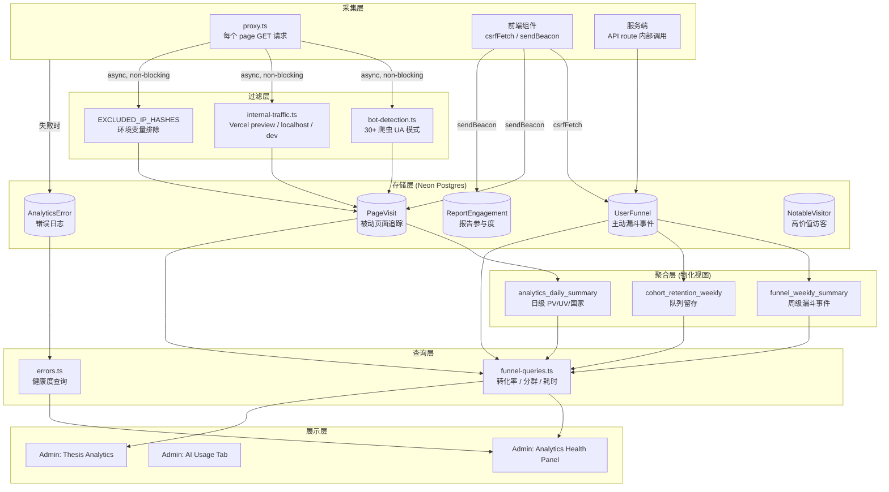

# Analytics Architecture

> 完整的分析系统架构：采集层 → 存储层 → 聚合层 → 查询层 → 展示层。

---

## 1. 系统总览



---

## 2. 采集层详解

### 2.1 被动采集 — PageVisit (middleware)

**触发**: `proxy.ts` 的 `afterResponse` 钩子，每个 page GET 请求自动触发。

| 字段                                | 来源                            | 说明                                                     |
| ----------------------------------- | ------------------------------- | -------------------------------------------------------- |
| `path`                              | `request.nextUrl.pathname`      | 页面路径                                                 |
| `ipHash`                            | SHA-256(IP).slice(0,16)         | 隐私保护的 IP 分组                                       |
| `userAgent`                         | request header (截取 512 字符)  | 浏览器标识                                               |
| `referer`                           | request header (截取 1024 字符) | 来源页面                                                 |
| `userId`                            | session cookie 解析             | 已登录用户关联                                           |
| `country` / `city` / `region`       | Vercel geo headers              | 地理位置                                                 |
| `deviceType`                        | UA 解析 (mobile/tablet/desktop) | 设备分类                                                 |
| `utmSource/Medium/Campaign/Content` | URL 参数                        | 营销归因                                                 |
| `visitSessionId`                    | cookie 或生成                   | 会话分组                                                 |
| `isBot`                             | `bot-detection.ts` 判定         | 爬虫标记 (bot visits now skipped entirely — no DB write) |
| `isInternal`                        | `internal-traffic.ts` 判定      | 内部流量标记                                             |
| `durationMs`                        | 客户端 sendBeacon 回填          | 页面停留时长                                             |

**隐私设计**:

- IP 永远不存原始值，仅存 SHA-256 前 16 位
- `EXCLUDED_IP_HASHES` 环境变量可排除创始人 IP
- bot + 内部流量标记但不删除（可用于质量分析）

### 2.2 主动采集 — UserFunnel (漏斗事件)

**触发**: 前端组件通过 `csrfFetch('/api/analytics/event')` 或服务端调用 `trackFunnelEvent()`。

```typescript
trackFunnelEvent("deepdive_completed", {
  userId: "xxx",
  clientId: "yyy", // 匿名用户备用标识
  metadata: { sessionId, timeMs },
  idempotencyKey: "dd:session123:completed",
});
```

**去重机制**: `idempotencyKey` 上有唯一索引，`ON CONFLICT DO NOTHING` 防止重复记录。

**Admin 过滤**: `isAdmin` 字段标记管理员操作，所有查询默认排除。

### 2.3 参与度采集 — ReportEngagement (sendBeacon)

**触发**: `report-engagement-tracker.tsx` 组件，使用 IntersectionObserver + scroll 监听。

| 指标           | 采集方式                                      |
| -------------- | --------------------------------------------- |
| 各版块停留时长 | IntersectionObserver 进入/离开时间差          |
| 滚动深度       | `window.scrollY / document.body.scrollHeight` |
| 回看检测       | 滚动方向反转 + 回到已离开版块                 |

**发送**: 页面 `beforeunload` 时通过 `sendBeacon` 发送（CSRF 豁免）。

### 2.4 错误采集 — AnalyticsError

**原则**: 分析系统的错误永远不能影响用户主流程。

```
try {
  await trackFunnelEvent(...)
} catch (error) {
  await logAnalyticsError('funnel', event, error)  // fire-and-forget
}
```

**错误流**: `console.error` (必定执行) → Sentry (best-effort) → `AnalyticsError` 表 (best-effort)

**5 个错误层**: `funnel` · `page_visit` · `engagement` · `identity` · `cron`

---

## 3. 过滤层详解

### 3.1 Bot Detection (`lib/analytics/bot-detection.ts`)

- 30+ 已知爬虫 UA 模式 (Googlebot, GPTBot, Selenium, PhantomJS 等)
- Bot traffic is **skipped entirely** — `trackPageVisit()` returns early without writing to DB (saves ~96% of PageVisit volume)
- `PageVisit.isBot` column still exists for legacy data; new bot visits are never written

### 3.2 Internal Traffic (`lib/analytics/internal-traffic.ts`)

- Vercel preview 环境检测
- localhost / 127.0.0.1 检测
- 开发者工具 UA 检测
- 检测结果写入 `PageVisit.isInternal`

### 3.3 Notable Visitor Detection (`lib/analytics/notable-detection.ts`)

- 8 项评分算法，score ≥ 8 标记为高价值访客
- 写入 `NotableVisitor` 表
- 用于识别潜在合作伙伴/投资人/媒体访问

---

## 4. 存储层 — 数据库表

| 表名               | 行为                      | 关键索引                       | 估计增长          |
| ------------------ | ------------------------- | ------------------------------ | ----------------- |
| `PageVisit`        | 被动，每次页面请求        | path, userId, createdAt, isBot | ~100-1000 行/天   |
| `UserFunnel`       | 主动，关键动作触发        | event, userId, idempotencyKey  | ~10-100 行/天     |
| `ReportEngagement` | 被动，报告页 beforeunload | reportId, userId               | ~1-10 行/天       |
| `AnalyticsError`   | 异常，错误发生时          | layer, createdAt               | 理想状态 ~0 行/天 |
| `NotableVisitor`   | 自动，score ≥ 8           | ipHash, score                  | ~0-5 行/天        |

---

## 5. 聚合层 — 物化视图

> 定义在 `scripts/migrations/018-create-materialized-views.sql`
> 详细字段和刷新策略见 `docs/product/funnel-definitions.md` §5

| 视图                      | 粒度 | 数据源            | 主要维度                  |
| ------------------------- | ---- | ----------------- | ------------------------- |
| `analytics_daily_summary` | 日   | PageVisit         | date × country            |
| `funnel_weekly_summary`   | 周   | UserFunnel        | week × event              |
| `cohort_retention_weekly` | 周   | User + UserFunnel | cohortWeek × activityWeek |

**刷新**: 当前手动执行。建议频率：daily summary 每天、funnel/cohort 每周。

---

## 6. 查询层 — API 与函数

### 6.1 漏斗查询 (`lib/analytics/funnel-queries.ts`)

| 函数                                        | 输入      | 输出                 | 用途           |
| ------------------------------------------- | --------- | -------------------- | -------------- |
| `getFunnelStats(days)`                      | 天数      | 事件×计数×去重用户   | 总览仪表盘     |
| `getConversionRates(days)`                  | 天数      | 10 步骤的去重用户数  | 转化率计算     |
| `getFilteredConversionRates(days, filters)` | 天数+筛选 | 同上，分群后         | A/B 测试对比   |
| `getFunnelStepTiming(days)`                 | 天数      | 7 个步骤对的中位耗时 | 瓶颈诊断       |
| `getFunnelFilterOptions(days)`              | 天数      | 4 维度可用值列表     | Admin 下拉菜单 |

### 6.2 健康查询 (`lib/analytics/errors.ts`)

| 函数                   | 输出                                            |
| ---------------------- | ----------------------------------------------- |
| `getAnalyticsHealth()` | 1h/24h/7d 错误数 + 按层分组 + 最近 5 条错误详情 |

### 6.3 API Endpoints

| Endpoint                           | Method | Auth       | CSRF | 说明             |
| ---------------------------------- | ------ | ---------- | ---- | ---------------- |
| `/api/analytics/event`             | POST   | write tier | 豁免 | 记录漏斗事件     |
| `/api/analytics/duration`          | POST   | 无         | 豁免 | 更新页面停留时长 |
| `/api/analytics/report-engagement` | POST   | 无         | 豁免 | 保存报告参与度   |

**CSRF 豁免原因**: 这 3 个端点使用 `sendBeacon` (无法设置自定义 header)，且只接收匿名追踪数据，无状态变更操作。

---

## 7. 展示层 — Admin 面板

| 面板             | 组件                                             | 数据源                 |
| ---------------- | ------------------------------------------------ | ---------------------- |
| Analytics Health | `components/admin/analytics-health-panel.tsx`    | `getAnalyticsHealth()` |
| AI Usage & Cost  | `components/admin/ai-usage-tab.tsx`              | LLMUsage 表            |
| Thesis Analytics | `components/admin/research/thesis-analytics.tsx` | 多表联合查询           |
| User Insights    | `components/admin/insights/insights-tab.tsx`     | 用户聚合数据           |

**未建**: 漏斗可视化仪表盘 (查询引擎已完成，缺 UI 组件)

---

## 8. 数据流质量保障

### 设计原则

1. **Never-crash**: 所有分析代码包裹在 try-catch 中，失败只记录不阻塞
2. **Idempotent**: 漏斗事件用 `idempotencyKey` 去重，防止重复计数
3. **Privacy-first**: IP 仅存 hash，admin 流量可排除，bot 自动标记
4. **Non-blocking**: middleware 追踪是 async fire-and-forget
5. **Layered errors**: 5 层错误分类，便于定位问题来源

### 已有的质量检查

| 检查         | 实现方式                                             |
| ------------ | ---------------------------------------------------- |
| Bot 过滤     | 30+ 模式匹配 → 直接跳过 DB 写入 (不再标记，而是丢弃) |
| 内部流量过滤 | Vercel preview + localhost + dev tools               |
| Admin 过滤   | `isAdmin` 字段，查询时 `WHERE isAdmin = FALSE`       |
| 重复事件     | `idempotencyKey` 唯一索引                            |
| 错误自愈     | 错误记录失败时静默降级 (避免递归)                    |

### 运维命令

```bash
# 每周追踪审计
/weekly-tracking

# 每日健康检查（含分析系统）
/daily-health
```

---

## 9. 未来演进路线

| 优先级 | 改进                | 说明                                         |
| ------ | ------------------- | -------------------------------------------- |
| P1     | 物化视图自动刷新    | Vercel Cron 或 GitHub Action，消除手动执行   |
| P2     | 漏斗可视化 Admin UI | 复用 `funnel-queries.ts`，展示转化漏斗图     |
| P2     | 留存曲线 Admin UI   | 复用 `cohort_retention_weekly`，展示队列留存 |
| P3     | 实时漏斗告警        | 日转化率 < 基准线 50% 时触发 Sentry alert    |
| P3     | UTM 归因仪表盘      | 复用 `analytics_daily_summary.campaignPV`    |
| P4     | 用户旅程回放        | 基于 PageVisit + UserFunnel 重建单用户路径   |
