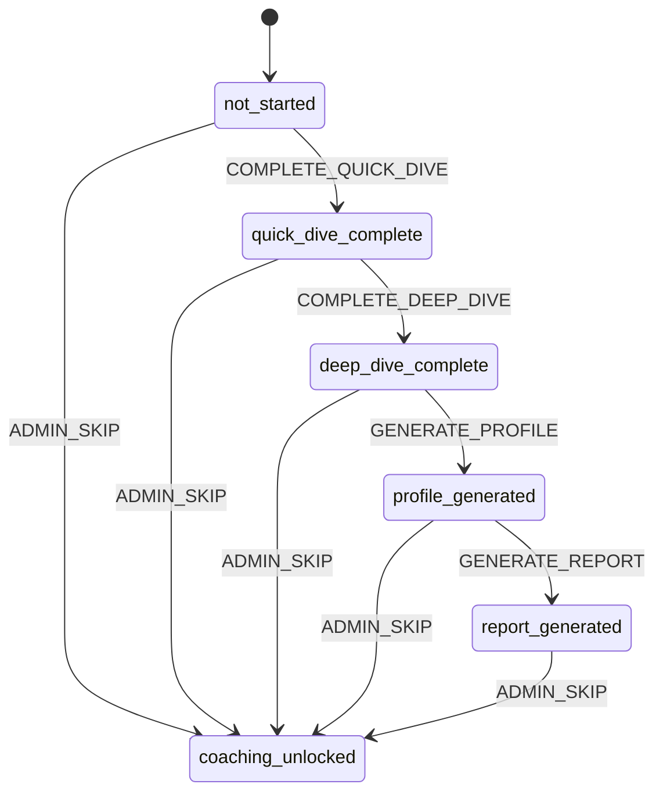
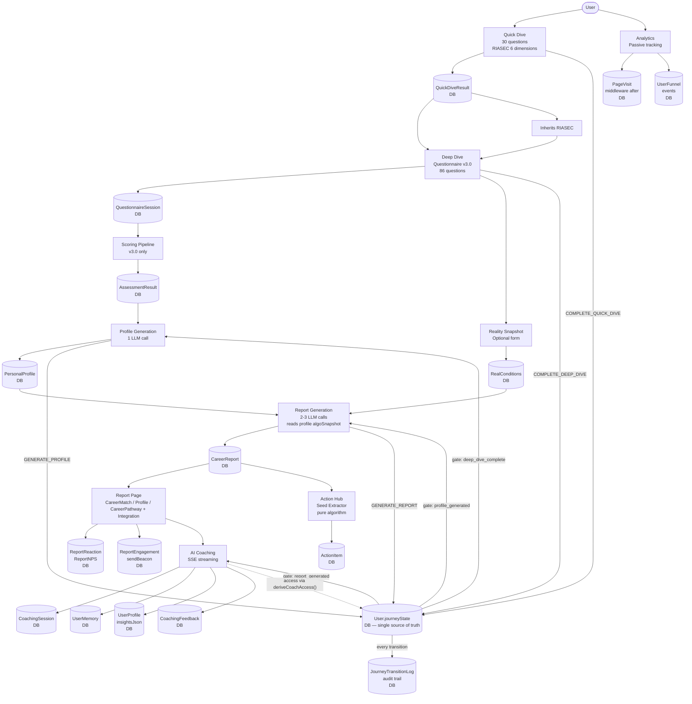
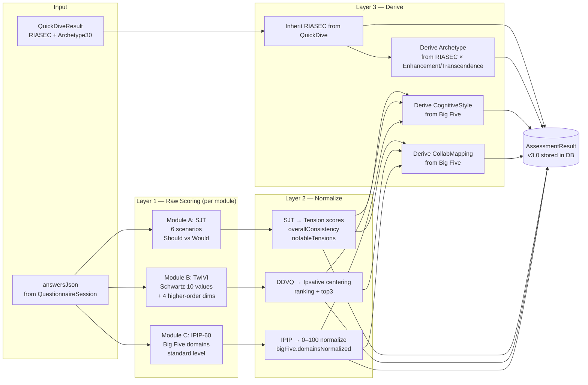
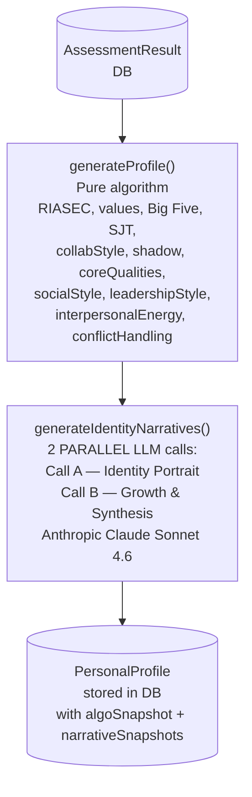
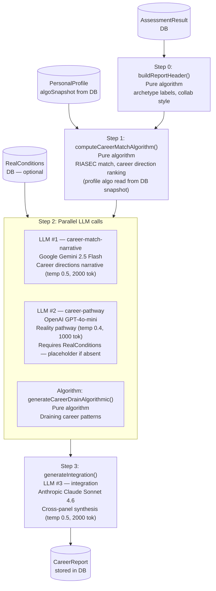
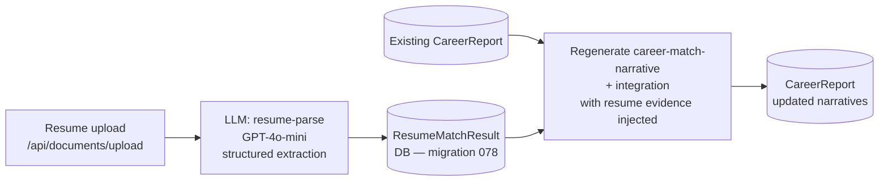
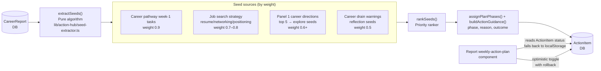
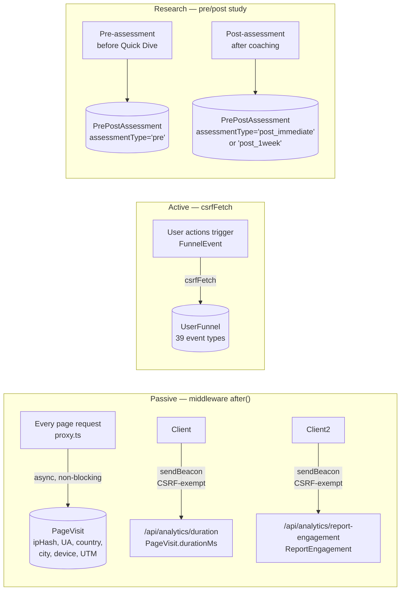

# Data Flow — Deep Dive Platform

Visual overview of the complete data pipeline, from user interactions through assessment, report generation, and coaching.

> **Last updated:** 2026-06-15

---

## 1. Journey State Machine — Coordination Layer

`journeyState` on the `User` row is the **single source of truth** for user progression. Every pipeline gate (profile generation, report generation, coaching access) derives its unlock status from this state. No pipeline runs unless the state machine permits it.

**Source:** `lib/journey/state-machine.ts` (pure FSM) + `lib/db/journey.ts` (atomic DB transitions)

**Access gating derived from state:**

| Feature                                  | Requires state >=     | Derived by            |
| ---------------------------------------- | --------------------- | --------------------- |
| Deep Dive questionnaire                  | `quick_dive_complete` | `deriveUnlocked()`    |
| Profile generation                       | `deep_dive_complete`  | `deriveUnlocked()`    |
| Report generation                        | `profile_generated`   | `deriveUnlocked()`    |
| Coaching (State 2, unlimited, 10 rounds) | `deep_dive_complete`  | `deriveCoachAccess()` |
| Coaching (State 1, limited, 3 rounds)    | `quick_dive_complete` | `deriveCoachAccess()` |

**Atomic transitions:** `transitionJourney()` uses a `WHERE "journeyState" = $current` clause to prevent race conditions. If another process already advanced the state, the update affects zero rows and the caller gets a conflict error.

**Audit trail:** Every transition is logged to `JourneyTransitionLog` (userId, fromState, toState, event, triggeredBy, metadata, createdAt). Log failures are non-blocking — they never prevent the transition itself.

---

## 2. Main Data Pipeline

The top-level journey: Quick Dive → Deep Dive → Report → Coaching. Each stage transition is gated by the journey state machine (Section 1).

---

## 3. Scoring Pipeline Internals

Three-layer architecture: Raw → Normalize → Derive.

**Rush detection thresholds:** SJT 3000ms · TwIVI 1500ms · IPIP 1200ms

---

## 4. Profile Generation Pipeline

Pure algorithm (0 LLM) for data + 2 parallel LLM calls for narratives. Runs after assessment completion, before report.

> `generateProfile()` is pure algorithm (0 LLM). It accepts optional `ProfileAlgorithmOutput` to avoid recomputation. Narrative generation (`generateIdentityNarratives()`) runs 2 parallel LLM calls (~15s total).

## 5. Report Generation Pipeline

2-3 LLM calls, ~65% algorithmic / ~35% LLM, 180-second pipeline timeout (90s per-call timeout).

**Progress streaming:** `generateCareerReport()` accepts an optional `onProgress?: ReportProgressCallback` parameter. SSE endpoints use this to stream real-time stage updates to the frontend: `"preparing"` → `"algorithms"` → `"career_match"` → `"integration"` → `"complete"`. Defined in `lib/report-generation/index.ts` as `ReportProgressStage` and `ReportProgressCallback`.

**Model fallback:** Each task has a configured fallback chain in `model-router.ts`. Career-match-narrative routes to Gemini (fallback: Anthropic, OpenAI). Integration and profile narratives route to Anthropic (fallback: Gemini). Career-pathway routes to OpenAI (fallback: Gemini). Circuit breaker + retry logic handle provider outages.

### 5b. Resume-Enhanced Report (optional, non-blocking branch)

User uploads a resume from the report page (`ReportDepthDialog`) → triggers an independent regeneration branch (`resumeAnalysis`) that does **not** block or re-run the main scoring/profile pipeline.

> Resume evidence is injected into the `career-match` + `integration` prompts only — scoring and profile algorithms are never re-run. See `lib/db/resume-match.ts` + `lib/types/report.ts`.

---

## 6. Action Hub Pipeline

Report → Action Hub: the seed extractor converts report content into DB-stored action items.

> **Unification (2026-03-15):** The report's weekly-action-plan component now reads/writes ActionItem status from the DB (matching by reportId + `panel3_week1` source dimension). Falls back to localStorage for unauthenticated users or when no Action Hub plan exists.

---

## 7. Analytics Tracking Flow

Passive and active tracking across the platform.

**Funnel events (39):** `registered` · `login` · `logout` · `landing_viewed` · `dashboard_viewed` · `quickdive_started` · `quickdive_completed` · `quickdive_abandoned` · `immersive_explore_started` · `immersive_explore_completed` · `immersive_exit_clicked` · `deepdive_started` · `deepdive_completed` · `deepdive_abandoned` · `profile_generated` · `report_generated` · `report_viewed` · `report_reacted` · `coaching_started` · `coaching_completed` · `share_clicked` · `profile_viewed` · `profile_tab_switched` · `profile_cta_clicked` · `profile_feedback_submitted` · `profile_transparency_toggled` · `action_hub_viewed` · `intro_cta_clicked` · `micro_feedback_shown` · `question_answered` · `progress_milestone` · `coaching_prompt_shown` · `report_nps_submitted` · `crisis_signal_detected` · `pipeline_started` · `pipeline_completed` · `pipeline_step_failed` · `report_generation_requested` · `report_generation_failed`

**CSRF-exempt endpoints:** `/api/analytics/duration` · `/api/analytics/report-engagement` (both use `sendBeacon` which cannot carry headers) · `/api/analytics/event` (used by micro-feedback components with bare fetch). All three endpoints only accept anonymous tracking data with no state-changing operations.
