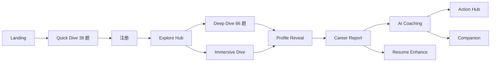

# Deep Dive — 产品全景

> 5-10 分钟读懂当前产品形态、模块边界、最近演进。
>
> 战略哲学见 [`product-principles.md`](./product-principles.md);
> 用户旅程见 [`user-journeys.md`](./user-journeys.md);
> 技术深度见 [`docs/architecture/`](../architecture/);
> 文档导航见 [`docs/INDEX.md`](../INDEX.md)。

---

## 1. 一句话定位

**AI Career Self-Discovery Platform — 跨文化职业身份深潜探索。**

不是"职业推荐引擎",是"自我理解平台"——通过心理评测 + 个人档案 + 叙事报告 + AI 教练,帮助用户理解"我是谁、什么职业方向值得我去探索"。

**核心信念**(详见 [`product-principles.md`](./product-principles.md)):

- **个性化分析,不是个性化过滤** — 不隐藏任何职业方向,只改变分析视角
- **报告点亮可能,而非规定结果** — Reports illuminate possibilities
- **教练引导自我发现,而非给建议** — Coaching guides self-discovery
- **算法优先,LLM 仅做叙事润色** — Profile = 0 LLM, Report = 2-3 LLM

**当前阶段**:论文 + 产品双轨并行,通过邀请码 cohort 进入。

| Cohort        | 用途                      | 进入方式 | 当前权限                                   |
| ------------- | ------------------------- | -------- | ------------------------------------------ |
| `thesis_2026` | 论文研究队列 (A/B 随机)   | 邀请码   | 全功能 + 研究问卷 + 同意书 (社交关闭)      |
| `beta_2026`   | 早期产品测试              | 邀请码   | 全功能 + 社交开放 (无研究问卷, 教练 10/天) |
| `default`     | 免费层 (未持有有效邀请码) | 公开注册 | 全部锁定 (展示页 + Quick Dive 入口)        |

---

## 2. 产品功能矩阵

按用户视角列出当前所有功能模块。

| 模块                       | 用户价值                              | 入口路由                                       | 状态 | 详细文档                                                           |
| -------------------------- | ------------------------------------- | ---------------------------------------------- | ---- | ------------------------------------------------------------------ |
| **Landing**                | 产品入口 · v8 The Descent 滚动下潜    | `app/[locale]/(marketing)/`                    | 生产 | [`user-journeys.md`](./user-journeys.md)                           |
| **Quick Dive (经典)**      | 38 题 RIASEC + TwIVI 价值观初筛       | `app/[locale]/(immersive)/quickdive/`          | 生产 | [`scoring-pipeline.md`](../architecture/scoring-pipeline.md)       |
| **Immersive Dive**         | 7 章 + 6 同伴 + 揭晓场景的叙事沉浸版  | `app/[locale]/(immersive)/immersive-dive/`     | 生产 | (沉浸版 = Quick Dive 的同等评测,叙事壳)                            |
| **Deep Dive**              | 86 题 v3.0 (IPIP-60 + DDVQ21 + SJT)   | `app/[locale]/(immersive)/deepdive/`           | 生产 | [`scoring-pipeline.md`](../architecture/scoring-pipeline.md)       |
| **Profile Reveal**         | 个人档案揭示动画                      | `app/[locale]/(immersive)/profile-reveal/[id]` | 生产 | [`profile-generation.md`](../architecture/profile-generation.md)   |
| **Personal Profile**       | 12 型原型 + Monograph Museum 档案馆   | `app/[locale]/(app)/profile/[id]`              | 生产 | [`profile-generation.md`](../architecture/profile-generation.md)   |
| **Career Report**          | 5 章叙事报告 (锚点→景观→阴影→信→方法) | `app/[locale]/(report)/report/[id]`            | 生产 | [`report-generation.md`](../architecture/report-generation.md)     |
| **Resume-enhanced Report** | 上传简历后重生成 (career-match 注入)  | 报告页 → `ReportDepthDialog` → 重新生成        | 生产 | [`report-generation.md`](../architecture/report-generation.md)     |
| **AI Coaching**            | SSE 流式 Socratic 五阶段对话          | `app/[locale]/(app)/coaching/`                 | 生产 | [`coaching-system.md`](../architecture/coaching-system.md)         |
| **Action Hub Sanctuary**   | 3-tier 行动计划 (lite/deep/personal)  | `app/[locale]/(app)/action-hub/`               | 生产 | (Sanctuary surface,LLM enrichment + keystone attribution)          |
| **Companion v1**           | 用户社交连接 (1v1 邀请、屏蔽、举报)   | `app/[locale]/(app)/companions/`               | 生产 | (M0-M3 全量,migrations 086-090)                                    |
| **Reports List**           | 历史报告列表与切换                    | `app/[locale]/(app)/reports/`                  | 生产 | —                                                                  |
| **Settings**               | 邀请码、账户、隐私、删除              | `app/[locale]/(app)/settings/`                 | 生产 | [`auth-security.md`](../architecture/auth-security.md)             |
| **Admin**                  | Admin SaaS · 12 子路由 + 论文口径单源 | `app/[locale]/(app)/admin/`                    | 生产 | [`cohort-entitlements.md`](../architecture/cohort-entitlements.md) |
| **Public Share**           | 报告分享卡片                          | `app/[locale]/(public)/share/[code]`           | 生产 | —                                                                  |
| **Pricing**                | 定价页 (隐藏导航,等 WTP 调研)         | `app/[locale]/(marketing)/pricing/`            | 隐藏 | (定价方案已建,不在主导航暴露)                                      |
| **Ultra Deep Dive**        | 多语言深层评测 (规划中)               | —                                              | 规划 | [`ultra-deep-dive-spec.md`](./ultra-deep-dive-spec.md)             |

---

## 3. 用户旅程速览



**6 态状态机** (`lib/journey/state-machine.ts`):

```
not_started
  → quick_dive_complete  (COMPLETE_QUICK_DIVE)
  → deep_dive_complete   (COMPLETE_DEEP_DIVE)
  → profile_generated    (GENERATE_PROFILE)
  → report_generated     (GENERATE_REPORT)
  → coaching_unlocked    (终态;ADMIN_SKIP 可从任意态跳到这里)
```

> 每一态 = 一个解锁里程碑。教练访问、功能可见性都从此状态机派生 (`deriveCoachAccess`, `deriveUnlocked`)。

完整旅程图 (含 mermaid + 所有分支与退出点) 见 [`user-journeys.md`](./user-journeys.md)。

---

## 4. 评测体系

### Quick Dive (38 题,~5 分钟)

- 30 题 RIASEC 兴趣 (Realistic / Investigative / Artistic / Social / Enterprising / Conventional)
- 8 题 TwIVI 价值观 (Schwartz Enhancement ↔ Transcendence)
- 输出:RIASEC Top-1 + 价值观倾向 → 12 型原型初判

### Deep Dive v3.0 (86 题,~20 分钟)

`runScoringPipelineV3()` in [`lib/scoring/index.ts`](../../lib/scoring/index.ts):

- **IPIP-60** — Big Five 人格 (60 题)
- **DDVQ21 / TwIVI 扩展** — Schwartz 价值观 21 题
- **SJT (Situational Judgment Test)** — 5 题情境差异判断
- **输出**:`AssessmentResultV3` (Big Five + RIASEC + Schwartz + Cognitive Style + Collaboration Style + IPC + TKI)

### 12 型原型 (RIASEC × Enhancement/Transcendence)

> 命名是核心 IP,**禁止 LLM 批量替换**,只增不改。

| 主导维度            | Enhancement (个人成就)   | Transcendence (利他/共同体) |
| ------------------- | ------------------------ | --------------------------- |
| **R** Realistic     | 工程专家 / **Architect** | 主心骨 / **Backbone**       |
| **I** Investigative | 战略家 / **Tactician**   | 科学家 / **Researcher**     |
| **A** Artistic      | C 位 / **Icon**          | 追梦人 / **Dreamweaver**    |
| **S** Social        | 伯乐 / **Mentor**        | 疗愈师 / **Healer**         |
| **E** Enterprising  | 王牌 / **Ace**           | 先驱 / **Pioneer**          |
| **C** Conventional  | 总指挥 / **Commander**   | 仲裁人 / **Arbiter**        |

详见 [`archetype-system.md`](../architecture/archetype-system.md) + [`archetypes-12-overview.md`](../reference/archetypes-12-overview.md)。

### 计算分层

| 阶段                 | LLM 调用数 | 说明                                                         |
| -------------------- | ---------- | ------------------------------------------------------------ |
| **Personal Profile** | **0**      | 纯算法,`generateProfile()` 输出 `algoSnapshot`               |
| **Career Report**    | 2-3        | header + career-match + integration (resume 路径多 1)        |
| **Coaching**         | 流式       | 每轮 1 次 SSE 调用,注入 profile + report + memory + 回合指令 |

**术语**:

- 我们对外不说 RIASEC / Big Five / Schwartz — 用 "Cognitive Style" / "Collaboration Style" 等品牌化表达 (避免 MBTI/DISC 的刻板印象)
- 跨文化置信度硬上限 55%

---

## 5. AI 与基础设施

### 路由入口 — `lib/ai/model-router.ts`

**所有 LLM 调用必须走 model-router**,绝不直接 import provider client。

```
callLLM(task, messages, options) → routes by task → primary provider with fallback chain
streamLLM(task, messages, options) → SSE streaming (coaching only)
```

**11 个 LLM Task** (TASK_CONFIG):

| Task                     | 主要 Provider | 用途                                |
| ------------------------ | ------------- | ----------------------------------- |
| `profile-narrative`      | Claude Sonnet | 个人档案 panel 叙事                 |
| `career-match-narrative` | Gemini Flash  | 职业匹配叙事                        |
| `integration`            | Claude Sonnet | 报告整合篇 (Letter to Self)         |
| `career-pathway`         | Claude Sonnet | 职业路径建议                        |
| `coaching`               | Claude Sonnet | 教练对话主流                        |
| `coaching-first`         | Claude Sonnet | 教练首轮 (大上下文)                 |
| `coaching-summary`       | GPT-4o-mini   | 会话摘要                            |
| `resume-parse`           | GPT-4o-mini   | 简历结构化解析                      |
| `action-plan-enrich`     | GPT-4o-mini   | Action Hub 行动计划增强             |
| `memory-extract`         | GPT-4o-mini   | 用户记忆抽取                        |
| `career-tier-inference`  | GPT-4o-mini   | 职业 tier 推断 (离线 backfill 专用) |

详细 prompt + max_tokens + 调用点见 [`llm-call-inventory.md`](../architecture/llm-call-inventory.md)。

### Health-aware 路由 v2 (`lib/ai/provider-health.ts`)

- 滑窗 10 分钟成功率 < 80% → 自动把 provider 降到 fallback 链尾
- 不覆盖 circuit breaker (硬闸门优先)
- Kill switch:`LLM_HEALTH_ROUTING_DISABLED=1`
- 详见 [`ai-routing-v2.md`](../architecture/ai-routing-v2.md)

### Language Guard 三层防护

防 LLM 输出语言漂移 (英文站冒中文 / 反之):

```
Pass 1: detect (lib/i18n/language-detect.ts) → 比对 locale → 若不匹配
Pass 2: regenerate (lib/report-generation/language-guard.ts) → 强化 locale prompt 重生成
Pass 3: sanitize (兜底) → 替换/移除不匹配字段
```

Kill switch:`LANGUAGE_GUARD_DISABLED=1`。

### Provider 与模型

| 用途          | Provider  | 默认模型                           |
| ------------- | --------- | ---------------------------------- |
| 长文叙事      | Anthropic | `claude-sonnet-4-6`                |
| 结构化短输出  | OpenAI    | `gpt-4o-mini`                      |
| 职业匹配      | Google    | `gemini-2.5-flash`                 |
| E2E 测试      | Groq      | `llama-3.3-70b-versatile` (免费层) |
| 测试 fallback | Anthropic | `claude-haiku-4-5-20251001`        |

故障 Runbook 见 [`/.claude/rules/llm-provider-failover.md`](../../.claude/rules/llm-provider-failover.md)。

---

## 6. 数据与编排

### Assessment Pipeline FSM (4 步评估后管道)

`scoring → profile → narratives → report` — 由 cron worker 编排:

- 3 分钟 worker lock (避免并发)
- 5 分钟无心跳视为崩溃,自动 reclaim
- 指数退避重试 (`077-assessment-pipeline-backoff.sql`)
- `independent` 分支:`resumeAnalysis` 简历增强不阻塞主链

详见 [`assessment-pipeline.md`](../architecture/assessment-pipeline.md)。

### DurableJob 队列 (`migration 084`)

注册后置任务 (邮件、欢迎引导、研究招募) 走 DurableJob 队列,而非直接 inline 执行。
详见 [`durable-job-post-deploy-checklist.md`](../ops/durable-job-post-deploy-checklist.md)。

### Cron 路由 (`app/api/cron/`)

| Cron                        | 频率   | 用途                           |
| --------------------------- | ------ | ------------------------------ |
| `pipeline-worker`           | 1 分钟 | 评估管道 4 步 FSM 推进         |
| `job-worker`                | 1 分钟 | DurableJob 队列消费            |
| `llm-digest`                | 1 小时 | LLM 24h 健康摘要 + Sentry 告警 |
| `post1week-reminders`       | 每日   | 一周后回访提醒                 |
| `cleanup-old-data`          | 每日   | 旧数据清理                     |
| `process-deletion-requests` | 每日   | 用户删除请求处理 (GDPR)        |
| `refresh-analytics`         | 每日   | 物化视图刷新                   |
| `scan-notable`              | 每日   | NotableVisitor 扫描 (运营观察) |

### 健康检查

- `app/api/health/llm` — LLM provider 实时探测 (Bearer token 保护)

### 数据库

- **Neon Postgres**,**55 张表**,**104 个迁移文件** (编号 001-105,跳过 004)
- DDL 唯一来源:[`scripts/schema.sql`](../../scripts/schema.sql)
- 类型派生:`lib/db/schema-generated.ts` (跑 `npm run db:generate-types` 刷新)
- JSONB 列结构 + 表说明:[`docs/database/DATA-DICTIONARY.md`](../database/DATA-DICTIONARY.md)
- 数据流全图:[`docs/database/DATA-FLOW.md`](../database/DATA-FLOW.md)

**核心表分组** (50 张):

| 域            | 表 (示例)                                                                        |
| ------------- | -------------------------------------------------------------------------------- |
| 用户与认证    | `User`, `UserSession`, `OAuthAccount`, `PasswordResetToken`                      |
| 评测与档案    | `QuestionnaireSession`, `AssessmentResult`, `QuickDiveResult`, `PersonalProfile` |
| 报告          | `CareerReport`, `ResumeMatchResult`, `ReportGenerationLock`                      |
| 教练          | `CoachingSession`, `CoachMessage`, `CoachingTheme`, `CoachingFeedback`           |
| 行动          | `ActionPlan`, `ActionItem`, `ActionMilestone`                                    |
| 记忆与偏好    | `UserMemory`, `UserContext`, `UserAchievement`                                   |
| Companion v1  | `CompanionProfile`, `CompanionConnection`, `CompanionBlock`, `CompanionReport`   |
| Cohort & 研究 | `InviteCode`, `PrePostAssessment`, `ConsentRecord`                               |
| 评估管道      | `AssessmentPipeline`, `JourneyTransitionLog`, `DurableJob`                       |
| 漏斗与分析    | `UserFunnel`, `PageVisit`, `AnalyticsError`, `LLMUsageLog`                       |
| 内容          | `CareerDirection`, `AdminAnswerPreset`                                           |
| 删除与隐私    | `UserDeletionRequest`, `Post1WeekReminderLog`                                    |

---

## 7. 门控与权限

### 邀请码 → Cohort → Entitlement

```
邀请码兑换 → User.cohort 字段 → COHORT_CONFIG[cohort].entitlements → canAccess(cohort, feature)
```

文件:[`lib/cohort/entitlements.ts`](../../lib/cohort/entitlements.ts) + [`lib/cohort/config.ts`](../../lib/cohort/config.ts)

| 功能                | thesis_2026 | beta_2026  | default |
| ------------------- | ----------- | ---------- | ------- |
| Immersive Dive      | ✅          | ✅         | ❌      |
| Deep Dive           | ✅          | ✅         | ❌      |
| AI Profile          | ✅          | ✅         | ❌      |
| AI Report           | ✅          | ✅         | ❌      |
| AI Coaching         | ✅ (20/天)  | ✅ (10/天) | ❌      |
| Resume Enhancement  | ✅          | ✅         | ❌      |
| 研究问卷 (pre/post) | ✅          | ❌         | ❌      |
| 同意书要求          | ✅          | ❌         | ❌      |
| Companion (社交)    | ❌          | ✅         | ❌      |

详见 [`cohort-entitlements.md`](../architecture/cohort-entitlements.md)。

### 安全栈

- bcrypt 12 轮 + 30 天 session
- CSRF 双提交 cookie (`proxy.ts` 全局强制)
- `guardRoute()` 五级守卫 (anonymous / authenticated / admin / cohort-gated / feature-gated)
- 客户端状态变更 fetch 必须走 `csrfFetch` (原生 fetch 会被 403 silent-fail)

详见 [`auth-security.md`](../architecture/auth-security.md)。

---

## 8. 测试金字塔

| 层级     | 数量    | 工具       | 守护范围                                        |
| -------- | ------- | ---------- | ----------------------------------------------- |
| 单元测试 | ~70%    | Vitest     | 评分、状态流转、漏斗事件、数据转换              |
| 集成测试 | ~20%    | Vitest     | API 契约、DB 读写、认证守卫、cleanup 完整性     |
| E2E 测试 | 24 spec | Playwright | 关键转化:landing → QD → 注册 → DD → 报告 → 教练 |

**总测试数**:275 测试文件 (单元/集成) + 24 E2E spec (统计自 `__tests__/` 与 `e2e/`)

**E2E 边界**:

- ✅ 写 E2E:关键转化、支付、核心分享
- ❌ 不写 E2E:漏斗事件触发 (用单测 mock)、LLM 输出质量 (用 evals)、CSS/视觉

详见 CLAUDE.md "测试策略"章节 + [`narrative-eval-baseline.md`](../assessment/narrative-eval-baseline.md)。

---

## 9. 最近演进 (2026-03-08 → 2026-06-15)

按主题列重大变更,每条带关键代码/迁移/文档锚点。

### 🎨 Meridian 设计系统全站铺开 (2026-06)

- **设计语言**:"一个世界两个时辰" (noon ↔ midnight),正午/午夜双色板自动响应明暗模式
- **Page-Art 引擎**:每个 app 页面挂载独有背景绘画 (`app/[locale]/(app)/layout.tsx`)
- **Expedition Rail**:app 侧边导航融入景观;紫色全站退役 → Meridian 语义色
- **令牌库**:`app/globals.css` 的 `--md-*` 族 (基础层 hex + 语义层意图);QA 门控 `scripts/check-meridian-contrast.ts`
- **权威设计源**:[`.claude/skills/deepdive-design/SKILL.md`](../../.claude/skills/deepdive-design/SKILL.md)

### 🌊 Landing v8 "The Descent" (滚动即下潜)

- **滚动引擎**:`components/features/landing/use-dive-scroll.ts` — 滚动深度驱动 surface→photic→twilight→abyss 四档水罩
- **新组件**:`depth-rail.tsx` (固定深度导轨) · `sections/dive-compartments.tsx` (全宽叙事舱) · `stagger-words.tsx` (CJK-safe 分词) · `sections/final-cta.tsx` (午夜窗口)
- **删除**:旧 `product-showcase.tsx` 4 列网格 → 全宽交替叙事舱;复活 SixLights + TrustShelf 氛围层

### 📖 Monograph Museum 档案馆 (Profile 展示重设计 · Phase 2 迭代中)

- **新展示范式**:从"书籍"隐喻 → "档案馆"隐喻;`components/profile-panels/monograph-museum-hero.tsx` + `monograph-museum-model.ts`
- **职业地图升级**:`components/report/career-sea-chart-atlas.tsx` (海图) 替换旧散点图
- **后端不变**:`generateProfile()` 算法管道未动,纯展示层重构

### 💼 职业库 +48 AI 时代职业

- **迁移**:102 (行业词表规范化) · 103 (导入 48 新职业) · 104 (去重软删 12 条)
- **构成**:商业/管理 18 + 跨职能 18 + 前沿 12;`ai-native` 从 33 → **81** 职业
- **离线 backfill**:`scripts/backfill-career-job-zone-llm.ts` 用 `career-tier-inference` task (OpenAI) 推断职业 AI 时代分类 (ai-native / transformed / augmented / stable)

### 📊 Admin SaaS 重建 (论文运营座舱)

- **12 子路由**:users · invites · careers · analytics · research · insights · companion-reports · visitors · user-journey · ai · psychometrics · moderation
- **论文口径单源**:`lib/db/research-metrics.ts` — 标准化人群、T0/T1/T2 规则、漏斗身份缝合
- **运维座舱**:`components/admin/overview/overview-board.tsx`;规范见 [`admin-metrics.md`](../architecture/admin-metrics.md)

### 🆕 Companion v1 全量交付 (社交模块)

- **5 张新表**:`CompanionProfile`, `CompanionConnection`, `CompanionBlock`, `CompanionReport`, `CompanionConnectionCanonicalPair`
- **迁移**:086-090
- **路由**:`app/[locale]/(app)/companions/{[userId],page}.tsx`
- **API**:`app/api/companions/{blocks,connections,discover,profile,reports}/`
- M0~M3 完整闭环:onboarding → discover → trust+safety → admin queue
- 9 轮交叉审查及 P1/P2 修复 (TOCTOU、symmetric UNIQUE、friends_only 泄露等)
- 当前权限:仅 `beta_2026` cohort 开放 (`socialFeatures: true`)

### 🆕 Action Hub Sanctuary (3-tier 行动模式)

- **路由**:`app/[locale]/(app)/action-hub/{layout,page,loading}.tsx` (`surface="sanctuary"`)
- **API**:`/api/action-hub/plan` (GET/POST)
- 3 层模式:lite (轻量) / deep (深度) / personal (私人)
- LLM enrichment + keystone attribution
- Night-shift v2 重设计:任务密度 -43% (pull/depth/closed-loop)

### ✅ AI Routing v2 (Health-aware Fallback)

- **新增**:`lib/ai/provider-health.ts` (`selectHealthiest()`)
- **新文档**:[`ai-routing-v2.md`](../architecture/ai-routing-v2.md)
- 10 分钟窗口成功率 < 80% → 自动降级,不依赖人工干预
- Kill switch:`LLM_HEALTH_ROUTING_DISABLED=1`
- 与 circuit breaker 双层保护 (硬闸门 + 软优选)
- 起源:04-02→04-04 Anthropic key outage 复盘

### ✅ Resume-enhanced Report

- **组件**:`components/report/report-depth-dialog.tsx` — 标准 vs 增强模式选择器
- **迁移**:`078-resume-match-persistence.sql` (新表 `ResumeMatchResult`)
- **API**:`/api/documents/upload` 集成 `createResumeMatchResult()`
- **类型**:`lib/types/report.ts` + `lib/db/resume-match.ts`
- 用户可上传简历,触发 career-match + integration 重生成 (注入简历证据)

### ✅ Research Consent v2 (论文同意书加固)

- **迁移**:`081-consent-record.sql` (新表 `ConsentRecord`,append-only audit)
- **API**:`app/api/pre-post-assessment/consent/`
- SCC-12 canonical + idempotent timestamp + T0 backfill
- **新文档**:[`research-lifecycle.md`](../architecture/research-lifecycle.md) — 研究数据生命周期 + 同意/撤回流程

### ✅ Language Guard 三层基础设施

- **检测层**:`lib/i18n/language-detect.ts` — `countScripts()` + `findMismatchedFields()`
- **保护层**:`lib/report-generation/language-guard.ts` — detect → regenerate → sanitize
- 支持 Latin / CJK / Hiragana / Katakana / Hangul / Cyrillic
- Kill switch:`LANGUAGE_GUARD_DISABLED=1`
- 起源:04-22 LLM 自发语言漂移事件 (英文 prompt 仍输出中文)

### ✅ Assessment Pipeline FSM + DurableJob 队列

- **迁移**:`075-report-generation-lock` / `076-assessment-pipeline` / `077-pipeline-backoff` / `084-durable-job-queue`
- 4 步 FSM (`scoring → profile → narratives → report`) + cron worker
- 3 分钟 lock + 5 分钟崩溃自愈 + 指数退避
- 注册后置任务从 inline 转 DurableJob 队列

### ✅ Revelation Editorial Shell 全量化

- **路径**:`app/[locale]/(report)/layout.tsx` (`SurfaceBoundary surface="revelation"`)
- 无 feature flag,默认全量渲染 (Landing / Dashboard / Profile / Report 四个 surface)
- 与 Sanctuary surface (Action Hub) 形成两类视觉语言

### 🛠️ 移动端 + ZH E2E 基线 + UX 修复轮

- mobile-zh 本地化 E2E 基线 + visual regression
- 5 项来自 2026-05-02 用户测试的 UX 修复
- Post-1week reminder log (migration 082)
- PrePostAssessment type repair (migration 083)
- Companion social_enabled flag (migration 085)

---

## 10. 文档导航 (按场景查阅)

### 我要改代码

1. [`CLAUDE.md`](../../CLAUDE.md) — 行为规则 + 关键文件引用
2. [`.claude/rules/impact-matrix.md`](../../.claude/rules/impact-matrix.md) — 改 A 必检 B
3. [`docs/architecture/`](../architecture/) — 单一子系统的深度文档
4. [`CONVENTIONS.md`](../../CONVENTIONS.md) — API/组件/测试/DB 模板

### 我要讨论产品

1. [`product-principles.md`](./product-principles.md) — 战略原则
2. **本文档** — 产品全景
3. [`user-journeys.md`](./user-journeys.md) — 用户旅程
4. [`coaching-companion-blueprint.md`](./coaching-companion-blueprint.md) — 教练 UX 蓝图
5. [`funnel-definitions.md`](./funnel-definitions.md) — 39 漏斗事件

### 我要排查 LLM 故障

1. [`/.claude/rules/llm-provider-failover.md`](../../.claude/rules/llm-provider-failover.md) — Runbook
2. [`docs/architecture/llm-call-inventory.md`](../architecture/llm-call-inventory.md) — 全部 LLM 调用清单
3. [`docs/architecture/sentry-llm-alerts.md`](../architecture/sentry-llm-alerts.md) — Sentry 告警 source of truth
4. [`docs/ops/emergency-runbook.md`](../ops/emergency-runbook.md) — 评分/报告/教练故障

### 我要改设计

1. [`/.claude/skills/deepdive-design/SKILL.md`](../../.claude/skills/deepdive-design/SKILL.md) — UI/UX 设计系统
2. [`docs/design/`](../design/) — 视觉规范、动画原则、i18n、Header 架构

### 我要找数据

1. [`docs/database/DATA-DICTIONARY.md`](../database/DATA-DICTIONARY.md) — 50 表 + JSONB 列
2. [`docs/database/DATA-FLOW.md`](../database/DATA-FLOW.md) — 数据管道全图
3. [`scripts/schema.sql`](../../scripts/schema.sql) — DDL 唯一来源

### 完整文档地图

- [`docs/INDEX.md`](../INDEX.md) — 全部文档分类索引

---

## 11. 速查关键数字 (2026-06-15 快照)

| 指标                | 当前值                                           |
| ------------------- | ------------------------------------------------ |
| 数据库表            | **55** (`scripts/schema.sql`)                    |
| 数据库迁移          | **编号 001-105** (104 个文件)                    |
| 旅程状态机          | **6 态**                                         |
| 12 型原型           | **12** (RIASEC × Enhancement/Transcendence)      |
| LLM Tasks           | **11** (TASK_CONFIG,含 1 离线 backfill)          |
| Cron 路由           | **8**                                            |
| 健康端点            | **1** (`/api/health/llm`)                        |
| Cohort              | **2 active** (thesis_2026 / beta_2026) + default |
| 测试 (单元 + 集成)  | **275**                                          |
| 测试 (E2E)          | **24**                                           |
| 文档 (architecture) | **19**                                           |
| 文档 (product)      | **7** (含本文)                                   |
| LLM Provider        | **4** (Anthropic / OpenAI / Google / Groq E2E)   |

---

## 维护

- 每月运维日历自动检查 (见 [`/.claude/rules/ops-calendar.md`](../../.claude/rules/ops-calendar.md))
- 重大功能上线 → Phase 3 收尾时刷新本文档对应章节
- 数字漂移 → `/docs-sync` 抓取并报告
- 全量审计 → `/docs-audit` (季度执行)
