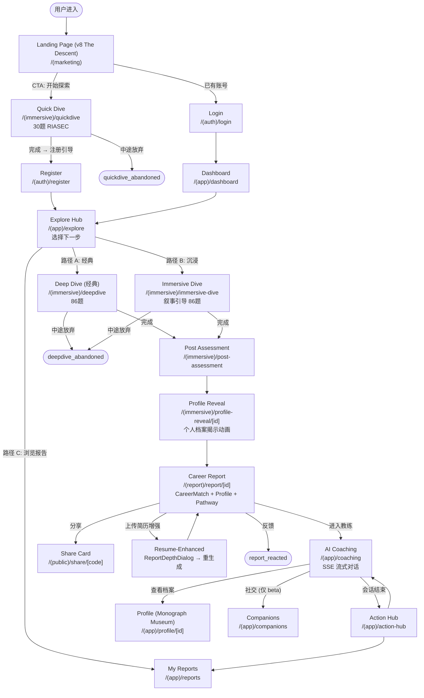
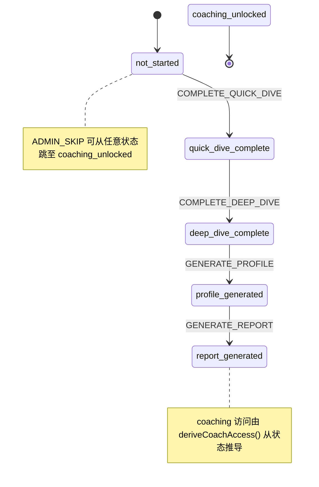

# User Journey Map — Deep Dive Platform

> 从用户视角的完整旅程地图，覆盖所有入口、决策点、分支路径和退出点。

---

## 1. 旅程总览



---

## 1b. 旅程状态机 (Journey State Machine)

> **Single source of truth for user progression.** 所有下游页面可见性、导航守卫、API 访问控制均从此状态机派生。
>
> 源码: `lib/journey/state-machine.ts` (FSM 定义) · `lib/db/journey.ts` (原子 DB 操作 + 审计日志)

### 状态与转换



| 状态                  | 对应旅程阶段        | 解锁内容                    |
| --------------------- | ------------------- | --------------------------- |
| `not_started`         | Phase 0 (Discovery) | Quick Dive 入口             |
| `quick_dive_complete` | Phase 1 完成后      | Deep Dive + 有限教练 (3 轮) |
| `deep_dive_complete`  | Phase 4 完成后      | 档案生成 + 无限教练         |
| `profile_generated`   | Phase 5 完成后      | 报告生成                    |
| `report_generated`    | Phase 6 完成后      | 完整教练 + Action Hub       |
| `coaching_unlocked`   | Phase 7+            | 全部功能 (终态)             |

### 关键设计决策

- **严格线性**: 每个状态只有一个前进事件 (+ ADMIN_SKIP)，不可回退。旅程永远只向前推进
- **原子转换**: DB UPDATE 带 WHERE 子句校验当前状态，防止并发竞争条件
- **审计日志**: 每次状态转换写入 `JourneyTransitionLog` 表 (fromState, toState, event, triggeredBy, metadata)，支持 system / admin / user 三种触发来源
- **派生函数**: `deriveUnlocked(state)` / `deriveUserLevel(state)` / `deriveCoachAccess(state)` 从单一状态派生所有访问控制，不查多表
- **Admin 跳跃**: `ADMIN_SKIP` 事件可从任意状态直达 `coaching_unlocked`，用于测试和客服场景

### 状态 → 访问控制映射

```typescript
// deriveUnlocked(state) 返回:
{
  quickDive: true,                                    // 始终可用
  deepDive: hasReached('quick_dive_complete'),        // Quick Dive 后解锁
  profile: hasReached('profile_generated'),           // 档案生成后可查看
  report: hasReached('report_generated'),             // 报告生成后可查看
  coaching: hasReached('report_generated'),            // 报告生成后解锁完整教练
}
```

---

## 2. 详细旅程阶段

### Phase 0: 发现 (Discovery)

| 维度         | 详情                                                        |
| ------------ | ----------------------------------------------------------- |
| **页面**     | `/(marketing)` Landing Page                                 |
| **用户目标** | 了解平台是什么、是否适合自己                                |
| **关键动作** | v8 "The Descent" 滚动下潜：Hero → 四档深度叙事舱 → 午夜 CTA |
| **追踪事件** | `intro_cta_clicked`                                         |
| **退出点**   | 关闭页面（无追踪）                                          |
| **决策点**   | "开始探索" vs "已有账号登录"                                |

### Phase 1: 快速探索 (Quick Dive)

| 维度           | 详情                                                                             |
| -------------- | -------------------------------------------------------------------------------- |
| **页面**       | `/(immersive)/quickdive` (经典) 或 `/(immersive)/quickdive/narrative` (叙事)     |
| **用户目标**   | 用最少时间获得初步职业方向感                                                     |
| **时长**       | 3-5 分钟 (30 题)                                                                 |
| **产出**       | RIASEC 6 维度分数 + 12 型原型初始匹配                                            |
| **追踪事件**   | `quickdive_started` → `quickdive_completed` / `quickdive_abandoned`              |
| **状态机转换** | 完成 → `COMPLETE_QUICK_DIVE` → `quick_dive_complete` (解锁 Deep Dive + 有限教练) |
| **数据存储**   | `QuickDiveResult` 表                                                             |
| **退出点**     | 中途关闭浏览器 → `quickdive_abandoned` (心跳检测)                                |
| **关键设计**   | 无需注册即可开始，降低进入门槛                                                   |

### Phase 2: 注册 (Registration)

| 维度         | 详情                                                  |
| ------------ | ----------------------------------------------------- |
| **页面**     | `/(auth)/register`                                    |
| **触发条件** | Quick Dive 完成后自动引导                             |
| **用户目标** | 保存结果、继续深度探索                                |
| **追踪事件** | `registered`                                          |
| **数据存储** | `User` 表 (含 `registrationCountry`, `researchGroup`) |
| **安全**     | bcrypt 12 轮 + 30 天 session                          |
| **研究分组** | 随机分配 `classic` / `immersive` (research 模式)      |

### Phase 3: 探索枢纽 (Explore Hub)

| 维度         | 详情                                                                                   |
| ------------ | -------------------------------------------------------------------------------------- |
| **页面**     | `/(app)/explore`                                                                       |
| **用户目标** | 选择下一步探索方向                                                                     |
| **追踪事件** | `immersive_explore_started` / `immersive_explore_completed` / `immersive_exit_clicked` |
| **决策点**   | 经典 Deep Dive vs 沉浸式 Immersive Dive                                                |
| **决策依据** | 研究分组（自动）或用户偏好（手动）                                                     |

### Phase 4: 深度探索 (Deep Dive)

| 维度           | 详情                                                                              |
| -------------- | --------------------------------------------------------------------------------- |
| **页面**       | `/(immersive)/deepdive` (经典) 或 `/(immersive)/immersive-dive` (沉浸)            |
| **用户目标**   | 完成完整心理测评，获取个性化职业报告                                              |
| **时长**       | 15-25 分钟 (86 题, v3.0)                                                          |
| **模块**       | Module A: SJT (6场景) → Module B: TwIVI (Schwartz) → Module C: IPIP-60 (Big Five) |
| **追踪事件**   | `deepdive_started` → `deepdive_completed` / `deepdive_abandoned`                  |
| **状态机转换** | 完成 → `COMPLETE_DEEP_DIVE` → `deep_dive_complete` (解锁档案生成 + 无限教练)      |
| **数据存储**   | `QuestionnaireSession` (逐题答案 + 每题反应时间)                                  |
| **质量控制**   | Rush detection: SJT 3000ms · TwIVI 1500ms · IPIP 1200ms                           |
| **断点续传**   | Zustand store 持久化，刷新不丢失                                                  |
| **退出点**     | 中途放弃 → `deepdive_abandoned` → 下次登录可继续                                  |

### Phase 4.5: 现实快照 (Reality Snapshot — 可选)

| 维度         | 详情                                               |
| ------------ | -------------------------------------------------- |
| **触发**     | Deep Dive 完成后、报告生成前                       |
| **用户目标** | 补充现实约束信息（签证、家庭、薪资等）以个性化报告 |
| **数据存储** | `RealConditions` 表                                |
| **可跳过**   | 是（报告使用 placeholder pathway）                 |

### Phase 5: 个人档案揭示 (Profile Reveal)

| 维度           | 详情                                                               |
| -------------- | ------------------------------------------------------------------ |
| **页面**       | `/(immersive)/profile-reveal/[id]`                                 |
| **用户目标**   | 以动画方式发现自己的心理画像                                       |
| **生成方式**   | `generateProfile()` = 纯算法 + 1 LLM 调用                          |
| **产出**       | 12 型原型 + Big Five + 认知风格 + 协作风格 + 价值锚点 + 阴影面     |
| **状态机转换** | 档案生成 → `GENERATE_PROFILE` → `profile_generated` (解锁报告生成) |
| **数据存储**   | `PersonalProfile` 表 (含 `algoSnapshot`)                           |
| **追踪事件**   | `profile_viewed`                                                   |

### Phase 6: 职业报告 (Career Report)

| 维度           | 详情                                                                                            |
| -------------- | ----------------------------------------------------------------------------------------------- |
| **页面**       | `/(report)/report/[id]`                                                                         |
| **用户目标**   | 获取个性化职业方向推荐和行动建议                                                                |
| **生成方式**   | 2-3 LLM 调用 (180s 超时)，65% 算法 / 35% LLM                                                    |
| **报告结构**   | Career Match (职业匹配) → Profile (人格画像) → Career Pathway (行动路径) → Integration (综合信) |
| **可选增强**   | 上传简历 (`ReportDepthDialog`) → career-match + integration 注入简历证据重生成 (独立非阻塞)     |
| **追踪事件**   | `report_generated` → `report_viewed` → `report_reacted`                                         |
| **状态机转换** | 报告生成 → `GENERATE_REPORT` → `report_generated` (解锁完整教练 + Action Hub)                   |
| **参与度追踪** | `ReportEngagement`: 各版块停留时长 + 滚动深度 + 回看检测                                        |
| **数据存储**   | `CareerReport` 表                                                                               |
| **用户反馈**   | `ReportReaction` (emoji) + `ReportNPS` (0-10 分)                                                |

### Phase 7: AI 教练 (Coaching)

| 维度           | 详情                                                                                         |
| -------------- | -------------------------------------------------------------------------------------------- |
| **页面**       | `/(app)/coaching`                                                                            |
| **用户目标**   | 与 AI 教练深入探讨职业方向、解答疑虑                                                         |
| **技术**       | SSE 流式对话，注入报告 + 档案 + 记忆上下文                                                   |
| **追踪事件**   | `coaching_started` → `coaching_completed`                                                    |
| **状态机转换** | 无显式转换 — coaching 访问由 `deriveCoachAccess(state)` 从 journeyState 推导                 |
| **访问分级**   | Quick Dive 后: 有限教练 (3 轮) · Deep Dive 后: 无限教练 — 由 `deriveCoachAccess(state)` 控制 |
| **数据存储**   | `CoachingSession` + `UserMemory` (Top 15) + `CoachingFeedback`                               |
| **退出点**     | 自然结束 / 关闭页面                                                                          |

### Phase 8: 行动枢纽 (Action Hub)

| 维度         | 详情                                   |
| ------------ | -------------------------------------- |
| **页面**     | `/(app)/action-hub`                    |
| **用户目标** | 查看教练建议的行动计划、追踪进展       |
| **追踪事件** | `action_hub_viewed`                    |
| **循环**     | Action Hub ↔ Coaching 形成持续探索循环 |

---

## 3. 分支路径

### 3a. 分享路径 (Share)

```
Report → share_clicked → Share Card /(public)/share/[code]
                        → 外部访客看到分享卡 → CTA → Landing → Quick Dive
```

### 3b. 公开档案路径 (Public Profile)

```
用户设置 username → /(public)/p/[username] 可被外部访问
```

### 3c. 回头用户路径 (Returning User)

```
Login → Dashboard → 查看历史报告 / 继续教练 / 重新探索
                  → Explore Hub → 新一轮 Deep Dive (新的 Session)
```

### 3d. 研究参与者路径 (Research Participant)

```
Pre-Assessment (before Quick Dive) → 正常旅程 → Post-Assessment (after Coaching)
                                                → 1-week Follow-up Assessment
数据存储: PrePostAssessment 表 (pre / post_immediate / post_1week)
```

### 3e. 社交连接路径 (Companion — 仅 beta cohort)

```
Profile/Report → Companions /(app)/companions
              → discover (发现潜在连接) → 1v1 邀请 → 接受 / 屏蔽 / 举报
门控: 仅 beta_2026 cohort (socialFeatures: true)；thesis_2026 关闭社交
数据存储: CompanionProfile / CompanionConnection / CompanionBlock / CompanionReport
```

---

## 4. 退出点与挽回策略

| 退出点           | 事件                                    | 当前挽回                   | 潜在优化                    |
| ---------------- | --------------------------------------- | -------------------------- | --------------------------- |
| Quick Dive 中途  | `quickdive_abandoned`                   | 无（匿名用户）             | 浏览器通知 / 邮件（需注册） |
| 注册环节         | 无事件（页面流失）                      | 无                         | 简化注册流程                |
| Deep Dive 中途   | `deepdive_abandoned`                    | 断点续传（Zustand 持久化） | 邮件提醒                    |
| 报告生成等待     | 无（超时）                              | 100s 超时 + 重试           | 进度条 + 预估时间           |
| 报告看完不进教练 | `report_viewed` 但无 `coaching_started` | 报告底部 CTA               | 延迟推送                    |

---

## 5. 关键指标定义

> 详细转化率定义和基准线见 `funnel-definitions.md`

| 指标         | 计算方式                                    |
| ------------ | ------------------------------------------- |
| **到达率**   | `quickdive_started` / Landing PV            |
| **完成率**   | `quickdive_completed` / `quickdive_started` |
| **注册转化** | `registered` / `quickdive_completed`        |
| **深度转化** | `deepdive_completed` / `registered`         |
| **报告阅读** | `report_viewed` / `deepdive_completed`      |
| **教练启动** | `coaching_started` / `report_viewed`        |
| **端到端**   | `coaching_started` / `quickdive_started`    |

---

## 6. 页面→Route Group 映射

| Route Group   | 页面                                                                       | 布局特征             |
| ------------- | -------------------------------------------------------------------------- | -------------------- |
| `(marketing)` | Landing                                                                    | 公开，无 Header      |
| `(auth)`      | Login, Register                                                            | 极简布局             |
| `(immersive)` | QuickDive, DeepDive, ImmersiveDive, ProfileReveal, PostAssessment          | 全屏沉浸，最小化导航 |
| `(app)`       | Dashboard, Explore, Coaching, ActionHub, Profile, Reports, Settings, Admin | 标准 App Header      |
| `(report)`    | Report                                                                     | 报告专用 Header      |
| `(public)`    | Share, Public Profile, Legal                                               | 公开，轻量 Header    |
